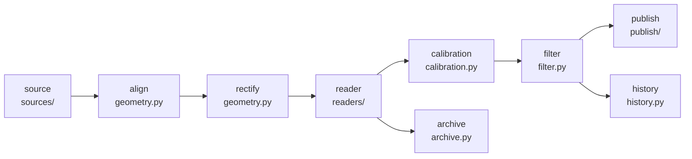

# CLAUDE.md

## Git: never mutate

**Claude must never make commits or run any git operation that changes state.** That includes
`commit`, `add`, `stash`, `checkout`/`switch`, `reset`, `restore`, `rebase`, `merge`, `cherry-pick`,
`tag`, `branch` create/delete, `push`, `pull` and `fetch`. Every mutating git operation is done by
the human. Read-only commands (`status`, `diff`, `log`, `show`, `blame`) are fine. When a piece of
work is ready, say so, summarize the changes, and suggest a commit message, but don't run it. Avoid
tools that write to git implicitly (e.g. use `uv init --vcs none`).

## What this is

A containerized service that fetches 4K JPEG frames of a heating-oil tank's float gauge from go2rtc
(`/api/frame.jpeg?src=<stream>`), finds the gauge's indicator disc with classical CV, converts its
position to a fill level, and publishes it to Home Assistant through MQTT discovery. The camera is
always in IR mode, so frames are grayscale. The design leaves room to swap in an ONNX model on
CUDA later through config. The MVP (milestones M0–M7) is complete. README.md is the user-facing
documentation (running the published image, calibration, Home Assistant); CONTRIBUTING.md is the
developer documentation (setup, tests, building, commits, CI and releases) and has the post-MVP
roadmap.

## Commands

Always go through `uv`. Never use `pip`, a bare `python`, or a hand-made venv.

```sh
uv sync                                  # create/refresh .venv from uv.lock
uv run pytest                            # unit + CV tests (integration tests are excluded)
uv run pytest -m integration             # needs Docker
uv run ruff format . && uv run ruff check .
uv run mypy                              # strict; covers src/ and tests/
uv run oiltank --help                    # the CLI
uv run oiltank read -c samples/calibration.yaml --image samples/frame0.jpg
uv run oiltank calibrate show -c samples/calibration.yaml --diagnostic check.jpg
uv run oiltank read -c samples/calibration.yaml   # live camera, configured in .env
uv run oiltank grab --out frame.jpg               # one frame, exactly as go2rtc sends it
uv run oiltank run                       # the service (needs data/calibration.yaml and MQTT)
uv run oiltank history / healthcheck / capture --every 10s --duration 1m
uv add <pkg> / uv add --dev <pkg>        # dependencies; commit uv.lock alongside pyproject.toml
docker build -t oiltank:dev .            # distroless runtime image (docker-compose.yml for deploys)
docker run --rm -v "$PWD/samples:/samples:ro" oiltank:dev read -c /samples/calibration.yaml --image /samples/frame0.jpg
# next release version; PSR only releases from main, so run it on an up-to-date main
uvx --exclude-newer 2026-09-29 --from python-semantic-release==10.7.0 semantic-release --noop version --print
docker run --rm -v "$PWD:/repo:ro" -w /repo rhysd/actionlint:1.7.12   # lint the workflows
GH_TOKEN=$(gh auth token) uvx zizmor==1.30.1 --persona=auditor .github  # audit the workflows
```

Python is **3.14** (`.python-version`, `requires-python`). Don't lower it to work around a missing
wheel; flag the problem instead.

## Architecture



`service.py` runs this loop; `pipeline.py` is the source-to-calibration part for one burst.

- `config.py`: settings from environment variables and `.env` (pydantic-settings, which reads
  `.env` with python-dotenv). See the conventions below.
- `sources/`: `FrameSource.grab(n, spacing_s) -> list[Frame]`. `http.py` talks to go2rtc's
  `/api/frame.jpeg`. It retries timeouts, connection errors and 5xx with backoff, and doesn't
  retry 401/403/404 or non-image responses (`CameraConfigError`). Bursts drop byte-identical
  frames and stop early, keeping what they have, if the camera drops out. `files.py` loads images
  from disk. Frames keep their encoded bytes (`Frame.data`), so a camera frame can become the
  reference without re-encoding.
- `geometry.py`: aligns each frame to an anchor patch of static parts (to tolerate camera bumps)
  and rectifies the gauge axis into an upright strip.
- `readers/`: `GaugeReader.read(strip) -> Reading`. **Readers return the gauge position `t` in
  [0, 1], never a level.** `calibration.py` maps `t` to a fill fraction, which lets you recalibrate
  without re-reading frames. Both the classical reader and the future ONNX reader produce a per-row
  score over the same strip and share the peak-finding and confidence code. **The ONNX import stays
  lazy**, so the CPU image never ships onnxruntime.
- `calibration.py`: the calibration model. A point's position is either `t` (along the axis, so it
  moves when the axis endpoints change) or `at` (frame px, fixed). Until there are two points the
  bottom of travel stands in for E and the top for F (`scale_points()`), and the end segments are
  extended past the outermost points. Use `.updated(...)` for changed copies; `model_copy`
  doesn't validate. `save()` keeps the file's header comment and writes `.bak`.
- `calibrate.py`: pure logic behind `oiltank calibrate`: starting values, the disc-size scan, the
  anchor self-test, rebase shifts, point edits, warnings. **The disc size matters:** an ellipse
  12-25% too small locks onto a highlight about 12 px above the disc with full confidence. So the
  scan follows the region of sizes that agree with the *starting* size and never just maximizes a
  score; on these frames that's a trap, because a template twice the disc height scores best.
- `cli/`: Typer app. `__init__.py` has `read` and `grab` and registers the rest:
  `calibrate.py` (the `calibrate` sub-commands), `mqtt.py` (`mqtt publish/clear`), `service.py`
  (`run`, `healthcheck`, `history`), `capture.py`. `common.py` has the shared helpers. Exit codes:
  0 OK, 1 no reading / camera or broker unreachable, 2 configuration or usage error. Use plain
  `X = tuple[...]` aliases in option annotations; Typer can't read `type X = ...` statements.
- `annotate.py`: the published gauge image (≤ 50 KB), the diagnostic view, the coordinate grid.
  OpenCV 5's fonts change their spacing with stroke thickness, so text outlines are drawn as offset
  copies.
- `pipeline.py`, `filter.py` and `publish/discovery.py` are **pure**: no I/O, easy to test.
- `filter.py`: `LevelFilter`, a state machine over `Observation`s that handles the confidence gate,
  median smoothing, confirmed refills, the Theil-Sen usage rate and days left. It's a function of
  the readings alone, so `service.py` rebuilds it on start and after a calibration change by
  replaying `history.py` (SQLite `data/oiltank.db`), with fractions recomputed from the stored `t`.
- `archive.py`: one record per reading under `data/archive/<UTC date>/`. A record is the JSON
  (reading, alignment, strip row ↔ t labels), the strip PNG, and sometimes the full frame's
  original bytes. The full-frame schedule is independent of problem frames. Oldest files go first
  beyond the size cap. `oiltank capture` writes the same format to `data/captures/` with no cap.
- `service.py`: one thread. It waits on the event queue (`READ_NOW`, `HA_ONLINE`, `CONNECTED`,
  `STOP`) or the next interval, then runs a cycle: grab → measure → filter → store → publish. It
  writes `data/heartbeat` at least every 30 s for `oiltank healthcheck`. `cli/service.py` installs
  SIGTERM/SIGINT handlers: as PID 1 in a container, Python ignores SIGTERM without one.
- `publish/mqtt.py`: paho-mqtt 2.x. `MqttLink` sets a last will (`offline`). On every (re)connect
  it subscribes and announces `online` and discovery. **CV never runs in paho callbacks**:
  callbacks do only cheap MQTT work and put `Event`s (`READ_NOW`, `HA_ONLINE`, `CONNECTED`) on a
  queue that the main loop handles (`service.py`, or `cli/mqtt.py` for publishing by hand).
- `model.py`: the typed, frozen dataclasses passed between stages.

## CI and releases

GitHub Actions, in `.github/workflows/`; CONTRIBUTING.md has the diagram.

- PRs run four separate workflows in parallel: `lint.yml`, `test.yml` (unit and integration jobs),
  `image.yml` and `pr-title.yml`. `image.yml` calls `build-image.yml`, which builds on native
  `ubuntu-24.04` and `ubuntu-24.04-arm` runners and smoke-tests each image (locked down, on the
  sample frames) before anything is pushed.
- `release.yml` runs on every push to `main`. It runs python-semantic-release (PSR), then
  `build-image.yml` with `push: true` if PSR released. That job publishes `ghcr.io/icooper/oiltank`
  as `X.Y.Z`, `X.Y`, `X` and `latest`. It doesn't re-run Lint and Test: the ruleset requires them
  with strict ("up to date") status checks, so the merged commit is the one they passed.
- **Releases are tag-only.** `main` needs signed commits through PRs, so CI never commits. PSR
  (`version --no-commit --tag`) tags the merge commit and creates the GitHub Release with
  `GITHUB_TOKEN`. **The version in `pyproject.toml` is a placeholder (`0.0.0`); never edit it.**
  `build-image.yml` stamps the release version with `uv version --no-sync`, which rewrites only
  that line and `uv.lock`'s root entry, just before `docker build`.
- PRs are squash-merged with the PR title as the commit message, and PSR reads it. So **commit
  messages and PR titles you suggest must be conventional**, typed by their effect on users:
  `feat` (minor), `fix`/`perf` (patch), `!` after the type (major), and `build`, `chore`, `ci`,
  `docs`, `refactor`, `style`, `test` (no release). `pr-title.yml`'s regex mirrors PSR's
  conventional parser; re-check it when upgrading PSR.
- Pinning: actions by full commit SHA with a `# vX.Y.Z` comment (Dependabot updates them); PSR by
  `PSR_VERSION` plus `PSR_EXCLUDE_NEWER` in `release.yml`, bumped together, because unpinned
  transitive dependencies (GitPython) have broken it; uv once, as `[tool.uv] required-version` in
  `pyproject.toml`. setup-uv reads it from there, so never give a `setup-uv` step a `version`.
  The Dockerfile's `ARG UV_VERSION` default must match; `test_uv_version.py` checks both.
- Every workflow sets `permissions: {}` and grants per job, except `build-image.yml`, which has no
  `permissions` on purpose: its jobs inherit the caller's grant (PRs `contents: read`, releases
  also `packages: write`), and a called workflow can only narrow it. Concurrency groups use a
  literal prefix, because in a called workflow `github.workflow` is the caller's name. Pass
  untrusted values (e.g. the PR title) to scripts through `env:`, never `${{ }}` inside `run:`.
  Check changes with actionlint and zizmor (see Commands).

## Conventions

- Diagrams in README.md, CONTRIBUTING.md and CLAUDE.md are Mermaid code blocks, never ASCII art.
- README.md is for people running the service; developer material goes in CONTRIBUTING.md. The
  configuration table stays in README.md.
- Strict typing (mypy strict). Prefer frozen dataclasses, and `pathlib` over `os.path`.
- Settings are `OILTANK_<SECTION>_<KEY>` with **single underscores** (e.g.
  `OILTANK_CAMERA_BURST_FRAMES`). Sections are split off at the first underscore
  (`env_nested_max_split=1`). So sections stay one level deep, and no top-level setting may start
  with a section name and `_`; `test_config.py` enforces this. Unknown `OILTANK_` names are errors.
  Adding a setting means adding it to `config.py`, to `.env.example` (as a commented-out default)
  and to the README's configuration table; `test_config.py` checks all three agree, names and
  defaults.
- `.env` is the whole container configuration. Compose passes it through, with no `environment:`
  block. Only the human writes it, and it holds real credentials: never print their values, copy
  the file, or commit it. To check it, load `Settings` and print which fields are set.
- Adding or changing an HA entity means editing `publish/discovery.py` and regenerating the golden
  `tests/data/discovery.json` (`UPDATE_GOLDEN=1 uv run pytest tests/unit/test_discovery.py`); review
  the diff. Unknown values are `null` in the state JSON, which templates render as `None` and HA
  shows as unknown.
- `docs/images/` is generated from the samples: `uv run oiltank read -c samples/calibration.yaml
  --image samples/frame0.jpg --image samples/frame1.jpg --annotate docs/images/gauge.jpg
  --diagnostic docs/images/diagnostic.jpg`, then the diagnostic shrunk to 80% at JPEG quality 82.
- `opencv-python-headless` is OpenCV **5.x**. `cv2` returns loosely typed `MatLike`; convert with
  `np.asarray(x, dtype=...)` at module boundaries.

## Testing

- Golden images are `samples/frame*.jpg`: native 3840×2160 go2rtc frames with the tank at about
  98% (owner's figure, a week after a fill). `DAY` (frame0-5, late afternoon, daylight through
  the window) and `NIGHT` (frame6-9, IR only, slightly brighter exposure) in `tests/conftest.py`
  list them. A test fails if a sample frame is in neither. The disc's centre is at
  **x ≈ 2168, y ≈ 1048 ± 4** in every frame; they agree within ~2 px, day or night.
- `samples/calibration.yaml` is their calibration, and the owner tunes it by hand. Its axis
  bounds the physical travel, from the dome cap down to the base ring. Its one point is the
  owner's 98% as an `at` position; E defaults to the bottom of travel, which puts F just above
  the disc (y ≈ 1045). Tests derive expected `t` values from the calibration (`axis.t_of`), never
  from hard-coded endpoints. They pin only the owner's reading: bursts read 98%.
- Synthetic CV tests are built from the sample strip: moving the disc, adding noise, JPEG
  re-encoding, frame shifts, and removing the disc.
- Integration tests are marked `integration` and need Docker. `tests/integration/conftest.py`
  starts an `eclipse-mosquitto:2.0.20` container per module, and each test gets its own device id.
  `test_service.py` runs `oiltank run` as a real process against `tests/fakes.py`'s fake go2rtc.
- Tests never see the developer's `.env` or `OILTANK_*` variables: the autouse `isolated_settings`
  fixture removes them and runs each test in an empty working directory. Camera tests use
  `httpx.MockTransport` (`test_http_source.py`) or a fake go2rtc on localhost (`test_cli_camera.py`).

## Don'ts

- Never put secrets, camera or go2rtc URLs with credentials, or `/data` contents in files meant for
  the repo. Real hosts and credentials live only in `.env`.
- Keep sample and test images small and few.
- The container must stay distroless and non-root (uid 65532), and must work with a read-only root
  filesystem.
