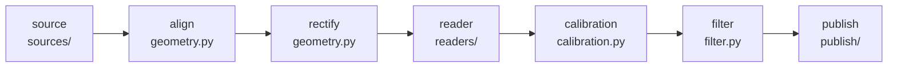

# CLAUDE.md

## Git: never mutate

**Claude must never make commits or run any git operation that changes state.** That includes
`commit`, `add`, `stash`, `checkout`/`switch`, `reset`, `restore`, `rebase`, `merge`, `cherry-pick`,
`tag`, `branch` create/delete, `push`, `pull` and `fetch`. Every mutating git operation is done by
the human. Read-only commands (`status`, `diff`, `log`, `show`, `blame`) are fine. When a piece of
work is ready, say so, summarize the changes, and suggest a commit message, but don't run it. Avoid
tools that write to git implicitly (e.g. use `uv init --vcs none`).

## What this is

A containerized service that fetches 4K JPEG frames of a heating-oil tank's float gauge from go2rtc
(`/api/frame.jpeg?src=<stream>`), finds the gauge's indicator disc with classical CV, converts its
position to a fill level, and publishes it to Home Assistant through MQTT discovery. The camera is
always in IR mode, so frames are grayscale. The design leaves room to swap in an ONNX model on
CUDA later through config.

## Commands

Always go through `uv`. Never use `pip`, a bare `python`, or a hand-made venv.

```sh
uv sync                                  # create/refresh .venv from uv.lock
uv run pytest                            # unit + CV tests (integration tests are excluded)
uv run pytest -m integration             # needs Docker
uv run ruff format . && uv run ruff check .
uv run mypy                              # strict; covers src/ and tests/
uv run oiltank --help                    # the CLI
uv run oiltank read -c samples/calibration.yaml --image samples/frame0.jpg
uv run oiltank calibrate show -c samples/calibration.yaml --diagnostic check.jpg
uv run oiltank read -c samples/calibration.yaml   # live camera, configured in .env
uv run oiltank grab --out frame.jpg               # one frame, exactly as go2rtc sends it
uv add <pkg> / uv add --dev <pkg>        # dependencies; commit uv.lock alongside pyproject.toml
docker build -t oiltank:dev .            # distroless runtime image (docker-compose.yml for deploys)
docker run --rm -v "$PWD/samples:/samples:ro" oiltank:dev read -c /samples/calibration.yaml --image /samples/frame0.jpg
```

Python is **3.14** (`.python-version`, `requires-python`). Don't lower it to work around a missing
wheel; flag the problem instead.

## Architecture



- `config.py`: settings from environment variables and `.env` (pydantic-settings, which reads
  `.env` with python-dotenv). See the conventions below.
- `sources/`: `FrameSource.grab(n, spacing_s) -> list[Frame]`. `http.py` talks to go2rtc's
  `/api/frame.jpeg`. It retries timeouts, connection errors and 5xx with backoff, and doesn't
  retry 401/403/404 or non-image responses (`CameraConfigError`). Bursts drop byte-identical
  frames and stop early, keeping what they have, if the camera drops out. `files.py` loads images
  from disk. Frames keep their encoded bytes (`Frame.data`), so a camera frame can become the
  reference without re-encoding.
- `geometry.py`: aligns each frame to an anchor patch of static parts (to tolerate camera bumps)
  and rectifies the gauge axis into an upright strip.
- `readers/`: `GaugeReader.read(strip) -> Reading`. **Readers return the gauge position `t` in
  [0, 1], never a level.** `calibration.py` maps `t` to a fill fraction, which lets you recalibrate
  without re-reading frames. Both the classical reader and the future ONNX reader produce a per-row
  score over the same strip and share the peak-finding and confidence code. **The ONNX import stays
  lazy**, so the CPU image never ships onnxruntime.
- `calibration.py`: the calibration model. A point's position is either `t` (along the axis, so it
  moves when the axis endpoints change) or `at` (frame px, fixed). Until there are two points the
  bottom of travel stands in for E and the top for F (`scale_points()`), and the end segments are
  extended past the outermost points. Use `.updated(...)` for changed copies; `model_copy`
  doesn't validate. `save()` keeps the file's header comment and writes `.bak`.
- `calibrate.py`: pure logic behind `oiltank calibrate`: starting values, the disc-size scan, the
  anchor self-test, rebase shifts, point edits, warnings. **The disc size matters:** an ellipse
  12-25% too small locks onto a highlight about 12 px above the disc with full confidence. So the
  scan follows the region of sizes that agree with the *starting* size and never just maximizes a
  score; on these frames that's a trap, because a template twice the disc height scores best.
- `cli/`: Typer app. `__init__.py` has `read`, `calibrate.py` the `calibrate` sub-commands,
  `common.py` the shared helpers. Use plain `X = tuple[...]` aliases in option annotations;
  Typer can't read `type X = ...` statements.
- `pipeline.py` and `publish/discovery.py` are **pure**: no I/O, easy to test.
- `publish/mqtt.py`: paho-mqtt 2.x. `MqttLink` sets a last will (`offline`). On every (re)connect
  it subscribes and announces `online` and discovery. **CV never runs in paho callbacks**:
  callbacks do only cheap MQTT work and put `Event`s (`READ_NOW`, `HA_ONLINE`, `CONNECTED`) on a
  queue that the main loop handles (`cli/mqtt.py` now, `service.py` in M5).
- `model.py`: the typed, frozen dataclasses passed between stages.

Not every module exists yet; the README's roadmap and the milestone list track progress.

## Conventions

- Diagrams in README.md and CLAUDE.md are Mermaid code blocks, never ASCII art.
- Strict typing (mypy strict). Prefer frozen dataclasses, and `pathlib` over `os.path`.
- Settings are `OILTANK_<SECTION>_<KEY>` with **single underscores** (e.g.
  `OILTANK_CAMERA_BURST_FRAMES`). Sections are split off at the first underscore
  (`env_nested_max_split=1`). So sections stay one level deep, and no top-level setting may start
  with a section name and `_`; `test_config.py` enforces this. Unknown `OILTANK_` names are errors.
  Every setting must also be listed in `.env.example`; a test checks that too.
- `.env` is the whole container configuration. Compose passes it through, with no `environment:`
  block. Only the human writes it, and it holds real credentials: never print their values, copy
  the file, or commit it. To check it, load `Settings` and print which fields are set.
- Adding or changing an HA entity means editing `publish/discovery.py` and regenerating the golden
  `tests/data/discovery.json` (`UPDATE_GOLDEN=1 uv run pytest tests/unit/test_discovery.py`); review
  the diff. Unknown values are `null` in the state JSON, which templates render as `None` and HA
  shows as unknown.
- `opencv-python-headless` is OpenCV **5.x**. `cv2` returns loosely typed `MatLike`; convert with
  `np.asarray(x, dtype=...)` at module boundaries.

## Testing

- Golden images are `samples/frame*.jpg`: native 3840×2160 go2rtc frames with the tank at about
  98% (owner's figure, a week after a fill). `DAY` (frame0-5, late afternoon, daylight through
  the window) and `NIGHT` (frame6-9, IR only, slightly brighter exposure) in `tests/conftest.py`
  list them. A test fails if a sample frame is in neither. The disc's centre is at
  **x ≈ 2168, y ≈ 1048 ± 4** in every frame; they agree within ~2 px, day or night.
- `samples/calibration.yaml` is their calibration, and the owner tunes it by hand. Its axis
  bounds the physical travel, from the dome cap down to the base ring. Its one point is the
  owner's 98% as an `at` position; E defaults to the bottom of travel, which puts F just above
  the disc (y ≈ 1045). Tests derive expected `t` values from the calibration (`axis.t_of`), never
  from hard-coded endpoints. They pin only the owner's reading: bursts read 98%.
- Synthetic CV tests are built from the sample strip: moving the disc, adding noise, JPEG
  re-encoding, frame shifts, and removing the disc.
- Integration tests are marked `integration` and need Docker. `tests/integration/test_mqtt.py`
  starts an `eclipse-mosquitto:2.0.20` container per module and gives each test its own device id.
- Tests never see the developer's `.env` or `OILTANK_*` variables: the autouse `isolated_settings`
  fixture removes them and runs each test in an empty working directory. Camera tests use
  `httpx.MockTransport` (`test_http_source.py`) or a fake go2rtc on localhost (`test_cli_camera.py`).

## Don'ts

- Never put secrets, camera or go2rtc URLs with credentials, or `/data` contents in files meant for
  the repo. Real hosts and credentials live only in `.env`.
- Keep sample and test images small and few.
- The container must stay distroless and non-root (uid 65532), and must work with a read-only root
  filesystem.
