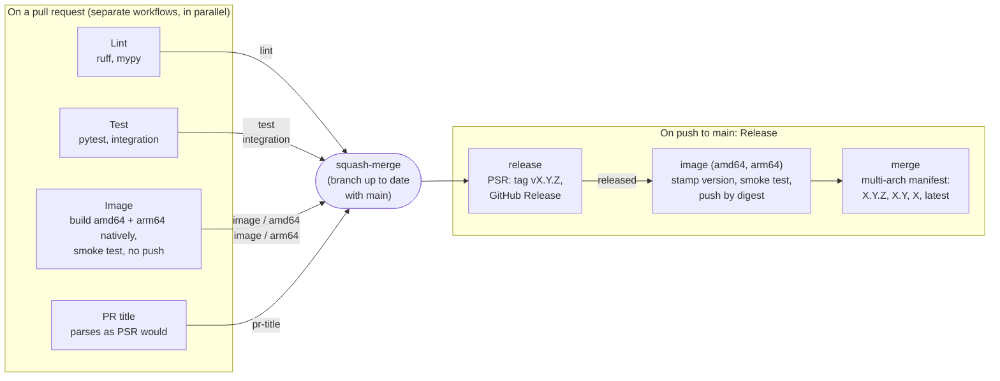

# Contributing <!-- omit from toc -->

How to build, test and change oiltank. [README.md](README.md) covers installing and running it.

- [Setup](#setup)
- [Running from a checkout](#running-from-a-checkout)
- [Code layout](#code-layout)
- [Tests](#tests)
- [Building the image](#building-the-image)
- [Commits and pull requests](#commits-and-pull-requests)
- [CI and releases](#ci-and-releases)
  - [Workflows](#workflows)
  - [How a release works](#how-a-release-works)
  - [Pinned tools](#pinned-tools)
- [Roadmap](#roadmap)

## Setup

The project uses [uv](https://docs.astral.sh/uv/) and Python 3.14. Always go through uv:

```sh
uv sync                                       # create .venv from uv.lock
uv run pytest                                 # tests (integration tests excluded)
uv run pytest -m integration                  # integration tests (need Docker)
uv run ruff format . && uv run ruff check .   # format + lint
uv run mypy                                   # strict type checking
uv run oiltank --help
```

## Running from a checkout

`uv run oiltank ...` reads `.env` and uses `./data`, the same directory the container mounts at
`/data`, so one `.env` works for both. Paths are local, such as `data/frame.jpg`. The sample frames
work without a camera or `.env`:

```sh
uv run oiltank read \
  -c samples/calibration.yaml \
  --image samples/frame0.jpg \
  --annotate gauge.jpg \
  --diagnostic check.jpg

uv run oiltank calibrate show \
  -c samples/calibration.yaml \
  --diagnostic check.jpg
```

## Code layout

The code is in `src/oiltank/`:

| Module | Does |
|---|---|
| `sources/` | Frames: go2rtc over HTTP (`http.py`) or image files (`files.py`) |
| `geometry.py`, `readers/`, `pipeline.py` | Align, rectify and read a burst; pure |
| `calibration.py`, `calibrate.py` | The calibration model, and the tools behind `oiltank calibrate` |
| `filter.py`, `history.py`, `archive.py` | Filtering and derived values (pure), SQLite history, the frame archive |
| `publish/` | Home Assistant discovery and state (pure), and the MQTT connection |
| `service.py` | The service loop |
| `annotate.py` | The gauge, diagnostic and grid images |
| `config.py`, `model.py`, `cli/` | Settings, shared data types, the command line |

[CLAUDE.md](CLAUDE.md) has the design rules that keep these apart.

## Tests

Sample frames for tests and development are in `samples/`. They are native 4K go2rtc captures,
taken a week after a fill with the tank at about 98%. `frame0`–`frame5` are from the late
afternoon, with daylight through the basement window. `frame6`–`frame9` are from late evening,
with IR only. The disc's centre is at y≈1048 in all of them. The tests cover:

- `tests/unit/`: calibration, geometry, peak finding, annotation, and the `read` and `calibrate`
  commands;
- `tests/cv/test_golden.py`: the real frames one by one, and day, night and mixed bursts;
- `tests/cv/test_synthetic.py`: the disc moved along its travel or removed; noise, JPEG, blur and
  gain/gamma; camera nudges and large moves; 1280×720 and 640×360 frames;
- `tests/cv/test_calibrate.py`: the calibration tools (disc-size scan, anchor check, rebase) on
  the real frames;
- `tests/unit/test_http_source.py` and `test_cli_camera.py`: the go2rtc source against a mocked
  transport, and the camera commands against a fake go2rtc on localhost (auth, retries, timeouts,
  wrong stream, duplicates);
- `tests/unit/test_config.py`: settings, `.env` and unknown-name detection. It also checks the
  configuration table in README.md against the code, so that table stays in the README;
- `tests/unit/test_discovery.py`: the discovery message, against the golden file
  `tests/data/discovery.json`, and the state payload;
- `tests/unit/test_filter.py`, `test_history.py` and `test_service.py`: the level filter (smoothing,
  refills, usage, problems), the SQLite history, and the service loop with a scripted camera;
- `tests/unit/test_archive.py`: archive records and their labels, the full-frame schedule, and the
  size limit; `test_cli_camera.py` also covers `capture`;
- `tests/integration/test_mqtt.py` and `test_service.py` (`-m integration`, need Docker): a real
  Mosquitto broker, covering retained discovery, state and image, the button and HA-restart
  events, the last will and `clear`. Also `oiltank run` end to end against a fake go2rtc,
  including the healthcheck and SIGTERM.

Tests never read your `.env` or `OILTANK_*` variables: they run in an empty working directory with
those variables removed.

New sample frames have to be listed as day or night in `tests/conftest.py`; a test fails until they
are.

## Building the image

```sh
docker build -t oiltank:dev .
docker run --rm -v "$PWD/samples:/samples:ro" oiltank:dev \
  read -c /samples/calibration.yaml --image /samples/frame0.jpg --image /samples/frame1.jpg
# level 98.1%  (t=0.820, confidence 1.00, indicator at x=2168.0 y=1047.3, 2 frame(s))
docker run --rm --read-only --cap-drop ALL --security-opt no-new-privileges oiltank:dev --version
```

`docker compose build` builds the same image under the published name,
`ghcr.io/icooper/oiltank:latest`, so `docker compose up` runs your build until the next
`docker compose pull`.

The Dockerfile works on both architectures: the only system library it adds, zlib, is staged from
`/usr/lib/$(uname -m)-linux-gnu`. CI builds amd64 and arm64 natively. Building arm64 on an amd64
machine needs QEMU (`docker run --privileged --rm tonistiigi/binfmt --install arm64`, which changes
the host's binfmt settings), then
`docker buildx build --platform linux/arm64 --load -t oiltank:arm64 .`.

A locally built image reports version `0.0.0`; see [How a release works](#how-a-release-works).

The images in `docs/images/` are generated from the samples:

```sh
uv run oiltank read \
  -c samples/calibration.yaml \
  --image samples/frame0.jpg \
  --image samples/frame1.jpg \
  --annotate docs/images/gauge.jpg \
  --diagnostic docs/images/diagnostic.jpg
```

Then shrink the diagnostic to 80% at JPEG quality 82.

## Commits and pull requests

PRs are squash-merged, and **the PR title becomes the commit on `main`**.
[python-semantic-release](https://python-semantic-release.readthedocs.io/) reads those commits to
decide each release, so the title must be a [conventional commit](https://www.conventionalcommits.org/):
`type(optional scope)!: subject`, with a lowercase type.

| Type | Release when merged |
|---|---|
| `feat` | minor (1.4.2 → 1.5.0) |
| `fix`, `perf` | patch (1.4.2 → 1.4.3) |
| `build`, `chore`, `ci`, `docs`, `refactor`, `style`, `test` | none |
| any type with `!` before the colon, e.g. `feat!: drop the v1 calibration format` | major (1.4.2 → 2.0.0) |

The **PR title** check enforces this, using the same pattern as python-semantic-release's parser, and
its summary says what the merge will release. The commits on the branch itself can say anything.

Every PR also runs **Lint**, **Test** and **Image**. All four have to pass.

## CI and releases



The arrow labels are the status checks the `main` ruleset requires. They're job names, so renaming
a job means updating the ruleset too.

### Workflows

| Workflow | Runs on | Does |
|---|---|---|
| `lint.yml` (Lint) | PRs | `ruff format --check`, `ruff check`, `mypy` |
| `test.yml` (Test) | PRs | `pytest`, and `pytest -m integration` as a parallel job |
| `image.yml` (Image) | PRs | Calls `build-image.yml` without pushing |
| `build-image.yml` | Called by Image and Release | Builds on native amd64 and arm64 runners and smoke-tests each image, locked down, on the sample frames. For a release it stamps the version, pushes by digest, and publishes the multi-arch tags |
| `pr-title.yml` (PR title) | PRs, including title edits | Checks the title is a conventional commit |
| `release.yml` (Release) | Pushes to `main` | python-semantic-release, then the image if there was a release |

### How a release works

On each merge, python-semantic-release (PSR) looks at the commits since the last `v*` tag. If any
of them is a `feat`, `fix`, `perf` or breaking change, it works out the next version, tags the
merge commit `vX.Y.Z`, and creates a GitHub Release with notes grouped by type. Otherwise it does
nothing.

**Releases are tag-only.** `main` only takes signed commits through PRs, so CI never commits a
version bump or a changelog. That's why:

- the version in `pyproject.toml` is a placeholder, `0.0.0`. **Don't edit it.** The image build
  stamps the release's version into `pyproject.toml` and `uv.lock` with `uv version` just before
  `docker build`, so `oiltank --version` and Home Assistant's software version are right in the
  published images;
- the release notes live on [GitHub Releases](https://github.com/icooper/oiltank/releases) rather
  than in a `CHANGELOG.md`;
- everything runs with the workflow's own `GITHUB_TOKEN`. The ruleset protects the `main` branch,
  not tags. Tags and releases made with that token don't trigger other workflows, so the image is
  built by a job in the same Release run.

If the image job fails after the tag exists, use **Re-run failed jobs** on that run. It rebuilds the
same version.

To see what the next release would be, on an up-to-date `main` (PSR only releases from `main`):

```sh
git fetch --tags
uvx --exclude-newer 2026-09-29 --from python-semantic-release==10.7.0 semantic-release --noop version --print
```

### Pinned tools

- **Actions** are pinned to full commit SHAs, with the version in a comment. Dependabot proposes
  updates weekly, for releases at least 14 days old, as `ci(deps): ...` PRs.
- **python-semantic-release** runs with `uvx`, not its GitHub Action: the action doesn't pin its
  dependencies, and a GitPython release has broken PSR before. `release.yml` pins
  `PSR_VERSION` and `PSR_EXCLUDE_NEWER`. `--exclude-newer` resolves PSR's whole dependency tree as
  PyPI was on that date. To upgrade, bump both together (the date a week or two after the PSR
  release), run the preview above, and check that the pattern in `pr-title.yml` still matches
  PSR's conventional parser (`commit_parser/conventional/parser.py` and `options.py`).
- **uv** is pinned once, as `[tool.uv] required-version` in `pyproject.toml`. The workflows'
  `setup-uv` steps read it from there. The Dockerfile can't, so its `UV_VERSION` default has to
  match, and `tests/unit/test_uv_version.py` checks that it does. uv refuses to run with any other
  version, so to upgrade, bump both, then `uv self update <version>`.

## Roadmap

- **A learned reader.** Train a small model on the archive's labelled strips and run it with
  ONNX Runtime, on the CPU or on an NVIDIA GPU (a `gpu` image variant with
  `onnxruntime-gpu`, enabled through config and the commented `deploy:` block in
  `docker-compose.yml`). The reader interface and the per-row score format are already shared.
- **A tank volume chart**, for gauges whose marks aren't fractions of volume.
- **Calibration points from a delivery capture and its ticket**, worked out automatically.
- **A learned background model** of the wall behind the dome, to separate the disc from clutter.
- **A direct RTSP source** (PyAV, as an optional extra) for setups without go2rtc.
